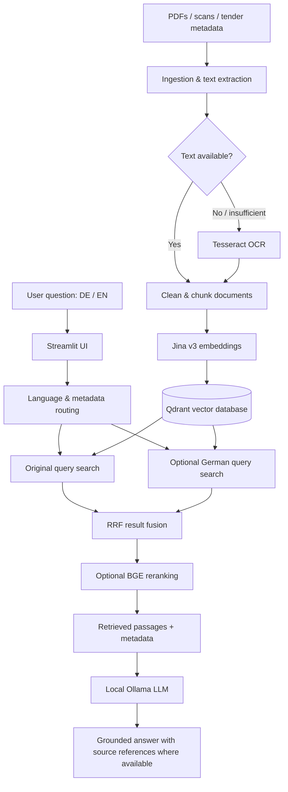

# Multilingual Tender RAG System


**A local, multilingual Retrieval-Augmented Generation (RAG) prototype for exploring German tender and procurement documents in German or English.**

The system combines PDF/OCR ingestion, document metadata, multilingual embeddings, Qdrant retrieval, optional reranking, and local LLM inference to answer questions using relevant source passages. It is designed for **document discovery and question answering**, **not automated cost estimation or quotation generation**.

## Why it matters

Public procurement and construction tender documents are often lengthy, technical, and scattered across different files. Finding an exact requirement, identifying a particular tender, or comparing document sections can take substantial manual effort.

This prototype provides a conversational search interface to help users locate and understand relevant information without uploading tender content to a hosted LLM service for answer generation.

**Example questions**

```text
Was ist DTAD-ID 20046891?
Show me tenders from 2024.
Welche Vergabeunterlagen sind für Straßenbau erforderlich?
What are the minimum wage requirements for construction?
Show me projects in the Berlin region.
```

> Answers depend on the documents indexed locally. The model is instructed to ground its answer in retrieved passages; generated responses must still be verified against original documents.

## Key capabilities

| Capability | Implementation |
| --- | --- |
| **Multilingual search** | German and English queries against primarily German tender content |
| **PDF understanding** | PyMuPDF text extraction with Tesseract OCR fallback for scanned/low-text pages |
| **Metadata-aware search** | Filtering and lookup using cleaned tender metadata such as DTAD-ID, year and region |
| **Semantic retrieval** | Jina Embeddings v3 with Qdrant vector search |
| **Query expansion/fusion** | Optional English-to-German routing; original and German query retrieval with Reciprocal Rank Fusion (RRF) |
| **Reranking** | Optional BGE reranker to refine retrieved passages |
| **Local answer generation** | Ollama with `qwen2.5:1.5b` as the default model |
| **User interface** | Streamlit chat application |

## Architecture



### Retrieval-to-answer sequence

1. **Ingest:** Read tender files and clean associated Excel metadata.
2. **Extract:** Use native PDF text where possible; apply OCR when needed.
3. **Index:** Split extracted text into overlapping chunks, embed with Jina v3, and store vectors in Qdrant.
4. **Route:** Interpret the user's language and structured lookup requirements (for example, DTAD-ID or year).
5. **Retrieve:** Search Qdrant using the original query and, optionally, a German-routed query; combine results using RRF.
6. **Rerank:** Optionally reorder candidates using a reranker.
7. **Generate:** Supply relevant passages to the local LLM and return an answer, with source information where available.

## Technology stack

| Layer | Technologies |
| --- | --- |
| Language | Python 3.10+ |
| Frontend | Streamlit |
| Document extraction | PyMuPDF, Tesseract, `pytesseract` |
| Metadata handling | pandas, Excel |
| Embedding model | `jinaai/jina-embeddings-v3` |
| Vector search | Qdrant |
| Fusion / reranking | Reciprocal Rank Fusion, optional BGE reranker |
| LLM runtime | Ollama |
| Default LLM | `qwen2.5:1.5b` |
| Local infrastructure | Docker Compose (Qdrant) |

## Prototype configuration

The repository's published documentation describes the following local configuration:

| Setting | Value |
| --- | --- |
| Indexed documents | 6,126 (reported local snapshot) |
| Embedding dimensions | 1,024 |
| Text chunk size | 1,000 characters |
| Chunk overlap | 400 characters |
| Candidate retrieval | 100 chunks |
| Final retrieved context | 16 passages |
| Local Qdrant endpoint | `http://127.0.0.1:6333` |
| Qdrant collection | `tender_docs_jina-v3_d1024_fresh` |

These are **reported prototype settings, not independently reproduced benchmark results**. Retrieval quality and latency will depend on the documents, hardware, and selected models.

## Getting started

### Prerequisites

- Python 3.10+
- Docker and Docker Compose
- [Ollama](https://ollama.com/)
- [Tesseract OCR](https://github.com/tesseract-ocr/tesseract) for scanned PDFs
- Sufficient memory/storage for embedding and indexing your document collection

### 1. Clone the repository

```bash
git clone https://github.com/ShalinVachheta017/multilingual-tender-rag.git
cd multilingual-tender-rag
```

### 2. Create an environment and install packages

```bash
python -m venv .venv
# Linux/macOS:
source .venv/bin/activate
# Windows PowerShell:
# .venv\Scripts\Activate.ps1

python -m pip install -r requirements.txt
```

### 3. Start Qdrant

```bash
docker compose up -d
curl http://127.0.0.1:6333/collections
```

Qdrant's local dashboard is typically available at <http://127.0.0.1:6333/dashboard>.

### 4. Prepare the local LLM

```bash
ollama pull qwen2.5:1.5b
ollama list
```

Make sure Ollama is running before using the chat interface.

### 5. Add documents, ingest, index, and launch

The repository contains `scripts/`, `src/`, and `ui/streamlit/` directories. Consult their current entry points and [PROJECT_DOCUMENTATION.md](PROJECT_DOCUMENTATION.md) for the command-line arguments and data paths used by your checkout.

> **Repository maintenance note:** An older README referenced the separate name `multilingual-ragbot` and different UI paths. Do not reuse those commands without confirming that the corresponding files exist. The clone command above uses this repository's actual URL.

Once the documents have been indexed in Qdrant, launch the Streamlit application using the entry point provided in the repository and open its local URL (usually <http://localhost:8501>).

## Example use cases

### Find a specific tender

**Question:** `Was ist DTAD-ID 20046891?`

**Expected workflow:** Recognize the identifier, retrieve matching metadata and related passages, and summarize the indexed record.

### Search across languages

**Question:** `What documentation is needed for a road construction tender?`

**Expected workflow:** Search with the English query and optionally a German translation, fuse candidates, rerank the passages, and answer in English using the retrieved German documents.

### Explore records by metadata

**Question:** `Show me tenders from 2024 in Berlin.`

**Expected workflow:** Use structured metadata and relevant retrieval results to locate matching tender records.

*These examples describe intended behavior, not guaranteed answers for a particular dataset.*

## Project status and limitations

**Status: working local prototype.** Current functionality includes document ingestion, OCR, metadata processing, Qdrant indexing, multilingual search, optional reranking, local answer generation, and a Streamlit interface.

The repository does **not** present this as a production-deployed service. Not yet fully implemented or validated:

- Production authentication, HTTPS, and secure credential management
- Full CI/CD, cloud deployment, and automated alerting
- Comprehensive RAG evaluation and benchmarking
- Production monitoring and operational hardening
- Automated construction cost estimation or quotation preparation

**Retrieval is not the same as pricing:** Understanding tender requirements is a useful foundation for construction estimation, but a trustworthy estimator would additionally require unit/quantity extraction, supplier data integration, deterministic costing rules, and human review.

## Suggested next steps

- Measure retrieval quality using labeled German/English tender queries (for example, Recall@k, MRR, nDCG).
- Evaluate answer grounding and abstention behavior when the requested information is absent.
- Benchmark dense retrieval against BM25 + dense hybrid retrieval.
- Add structured extraction of line items, quantities, and units from tender specifications.
- Improve document-level traceability and source highlighting in the UI.
- Add regression tests, monitoring, authentication, and deployment documentation.

## Repository resources

- [Source repository](https://github.com/ShalinVachheta017/multilingual-tender-rag)
- [Project documentation](PROJECT_DOCUMENTATION.md)
- [Architecture image](diagram.png)
- [License](LICENSE) — MIT

## Acknowledgments

Built with open-source tools and models from Jina AI, Qdrant, Ollama, Streamlit, PyMuPDF, and Tesseract OCR.
